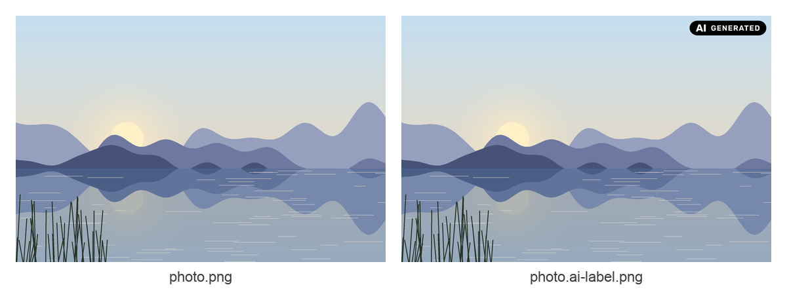
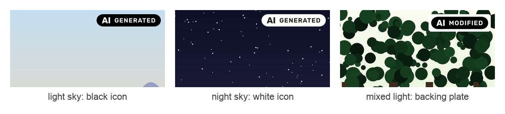
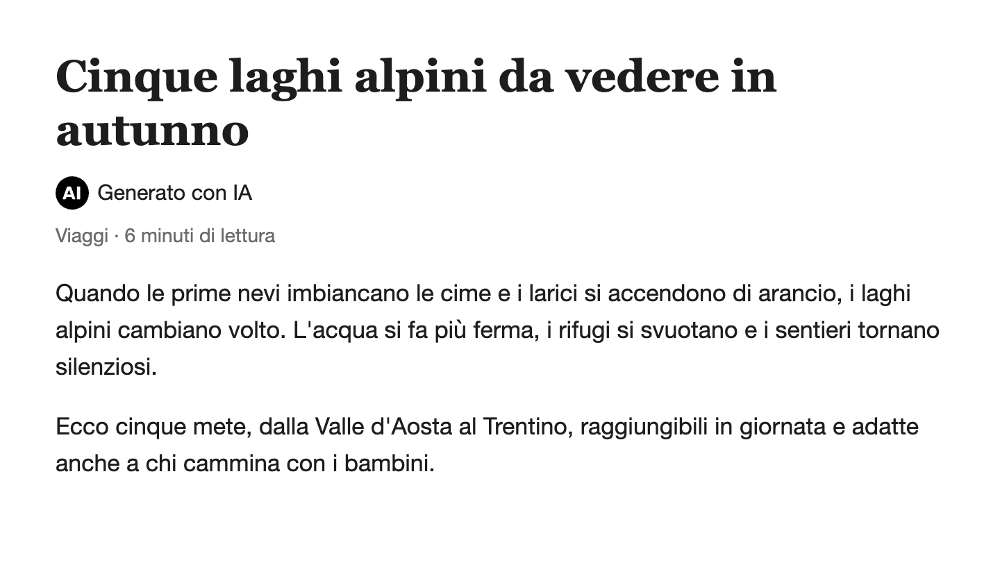
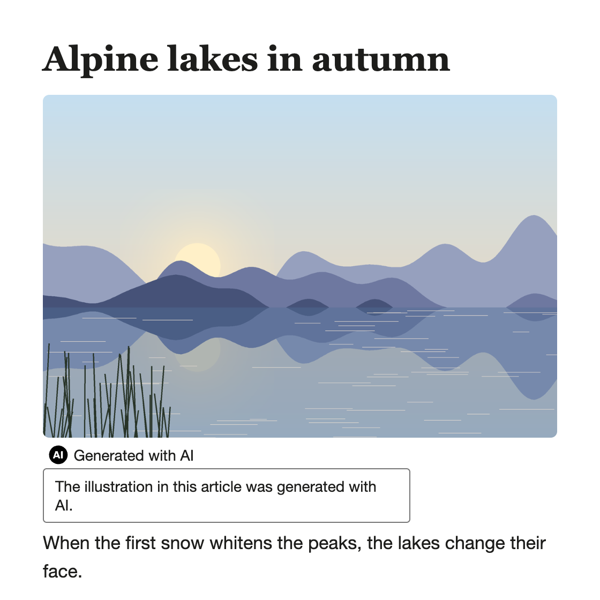

# eu-ai-labelling

A plugin for Claude Code and OpenAI Codex that puts the official **EU Icons** on AI-generated or AI-modified content as visible labels. It follows Article 50(4) of the EU AI Act and Section 2 of the Code of Practice on transparency of AI-generated content.

> **Not legal advice.** The plugin helps you apply labels. It does not tell you what the law requires of you and does not certify compliance. For your own situation, check the official guidance or ask a lawyer.
>
> **No adherence signal.** Using the EU Icons without signing the Code of Practice doesn't signal adherence to the Code of Practice.

## What it labels

| Content | What you get |
| --- | --- |
| [Images](#images) (PNG, JPEG, WebP) | A copy next to the original with the EU Icon burned in |
| [Videos](#videos) (MP4, MOV, WebM) | A copy next to the original with the EU Icon shown throughout or periodically |
| [Text](#text) (Markdown, HTML) | The document labelled in place, below the headline |
| [Creative works](#creative-works) | A caption below the image instead of an icon inside it |
| [Sites](#sites) | A label component for your stack (React, Vue, Astro or plain HTML) |

Original images and videos are never modified: you always get a separate Labelled Copy.



## Install

### Claude Code

```
/plugin marketplace add condensetech/eu-ai-labelling
/plugin install eu-ai-labelling@eu-ai-labelling
```

Run both: the first command only adds the marketplace, the second installs the plugin. Then start a new session (or run `/reload-plugins`) so `/eu-ai-labelling` shows up.

To check the install, run `claude plugin list` in a terminal: `eu-ai-labelling@eu-ai-labelling` should be listed as enabled.

### Codex

```
codex plugin marketplace add condensetech/eu-ai-labelling
```

Then open `/plugins` in Codex and install **EU AI Labelling**.

### Any agent (skills.sh)

The [`skills` CLI](https://github.com/vercel-labs/skills) from [skills.sh](https://www.skills.sh/) installs the skill on its own, without the plugin. It works with Claude Code, Codex, Cursor, Gemini CLI and other agents:

```
npx skills add condensetech/eu-ai-labelling
```

The CLI asks which agents to install it into. It installs into the current project; add `-g` to install it for all your projects instead.

The CLI needs Node 22.20 or later.

The entry point is the same as the plugin's: `/eu-ai-labelling` in Claude Code, `$eu-ai-labelling` in Codex.

To update it:

```
npx skills update
```

To pin a release, put its tag after `#` (the CLI reads a name after `@` as a skill name, not a release):

```
npx skills add condensetech/eu-ai-labelling#v0.1.0
```

### Requirements

- **Images:** [`uv`](https://docs.astral.sh/uv/), or Python 3.10+ with Pillow and resvg-py installed.
- **Videos:** also [FFmpeg](https://ffmpeg.org/download.html) (`ffmpeg` and `ffprobe`). The plugin doesn't install it: if it's missing, the agent gives you the install steps for your platform and checks again once you're done.
- **Documents and sites:** nothing else.

## Use

There is one entry point: `/eu-ai-labelling` in Claude Code, `$eu-ai-labelling` in Codex. The agent also picks the skill up on its own when you ask it to label content as AI-generated.

Claude Code:

```
/eu-ai-labelling label photo.png as fully AI-generated
/eu-ai-labelling label article.md as fully AI-generated
/eu-ai-labelling add AI labels to my site
```

Codex:

```
$eu-ai-labelling label photo.png as fully AI-generated
$eu-ai-labelling label article.md as fully AI-generated
$eu-ai-labelling add AI labels to my site
```

### Which icon

- Say "as fully AI-generated" or "as AI-modified" and that settles the icon.
- Leave it out (`/eu-ai-labelling label photo.png`) and the skill uses what you told it earlier, or asks whether AI created the content from scratch or edited something that already existed.

The skill doesn't tell you whether the law requires a Label for your content: that decision is yours. If you ask, it points you to the official Guidelines, the Code of Practice and the AI Act Service Desk (see [Sources](#sources)).

### Images

`label photo.png as fully AI-generated` writes `photo.ai-label.png` next to the original, with the "AI GENERATED" EU Icon burned in. The original is left untouched.

How the icon is placed:

1. The agent looks at the image and uses the **top-right corner** if it's free.
2. If not, it moves the icon to a clean corner, or asks you when no corner is clean.
3. It picks **black or white** for at least 3:1 contrast, and adds an opaque backing plate when neither is enough.
4. It shows you a **preview** before finishing.



You can ask for something else, e.g. "bottom-left, 80 px tall, in white". See [Placement defaults](#placement-defaults).

Formats:

- **Supported:** PNG, JPEG and WebP. The Labelled Copy keeps the original's colour profile and EXIF metadata; JPEGs are re-encoded at high quality.
- **Refused:** animated GIF or WebP, SVG images and other formats.

### Videos

`label clip.mp4 as fully AI-generated` writes `clip.ai-label.mp4` next to the original, with the EU Icon on an opaque backing plate in a fixed corner (top-right unless you ask for another). The original is left untouched.


#### When the Label shows

The agent asks whether you want the Label shown for the whole video or periodically. Without a preference:

- a video up to 60 seconds shows it **throughout**;
- a longer one shows it for 5 seconds from the start, then for 5 seconds every 60 seconds.

These are the plugin's defaults, not legal thresholds; the window and recurrence can be changed.

#### Preview and approval

1. Before labelling, the agent writes into a `<video>.label-preview` folder:
   - frames from different parts of the video;
   - a few short labelled excerpts, rendered exactly as the Labelled Copy will be (for periodic display, around the moments the Label appears and disappears).
2. It looks at the frames for faces, text, subtitles and the main subject, and proposes one corner that avoids them. If no corner is clear across the scenes, it asks you. The Label never moves during playback.
3. Previews are samples and can't prove the Label is clear in every frame, so **you approve the full Labelled Copy**.

#### What the copy keeps

- The container, codec, dimensions, rotation, frame timing (variable frame rates and start offsets included) and duration of the original.
- It copies every audio and subtitle track without re-encoding, with each track's language, title, default or forced flag and sync.
- On a rotated video, the Label sits at the corner of the picture as you see it.

The video stream itself is re-encoded to include the Label, so the copy is not bit-identical. Before the copy replaces a previous one, the tool decodes it and checks what it kept.

The copy stays in the original's container and codec: a MOV stays a MOV and a WebM stays a WebM, never converted to MP4. The container is read from the file, not its extension.

#### Supported videos

Videos of any length, in these combinations:

| Video | Container and codec | Tracks | Limits |
| --- | --- | --- | --- |
| SDR | MP4 or MOV with H.264 | any number of audio tracks, `mov_text` subtitles | none |
| SDR | WebM with VP9 or VP8 | at most one audio track | constant frame rate, not rotated |
| HDR10 | MP4 with HEVC (10-bit, BT.2020, PQ, with mastering display metadata) | any number of audio tracks, `mov_text` subtitles | constant frame rate, not rotated |
| HLG | HLG video in MP4 with HEVC (10-bit, BT.2020, HLG) | any number of audio tracks, `mov_text` subtitles | constant frame rate, not rotated |

HDR stays HDR:

- **HDR10** is never converted to SDR. The Label is set at SDR reference white (203 cd/m2) rather than the display's peak; the mastering metadata is kept and the content light levels are updated for the Label.
- **HLG** is never converted to SDR or PQ. The Label is set at HLG's reference white (75% of the signal), and no HDR10 metadata is added that the source doesn't carry.
- The tool checks the copy's 10-bit values and metadata. The preview frames are SDR renderings, so watch the copy on an HDR display to judge how it looks.

#### What stops

Any other video stops before anything is written, and the agent asks you how to proceed: nothing is converted or dropped silently. That includes:

- another codec inside MOV or WebM, such as ProRes or AV1;
- another container;
- other HDR: HDR10+ and Dolby Vision (whose extra metadata would be lost), or HDR10 without mastering metadata;
- a track the container can't carry unchanged;
- a data, timecode or attachment stream;
- a mirrored picture;
- a combination your FFmpeg build lacks the encoder for.

### Text

Markdown and HTML documents are labelled in place:

```
/eu-ai-labelling label article.md as fully AI-generated
```

Below the headline, this adds:

- the Basic "AI" EU Icon: in HTML as an accessible inline SVG, in Markdown as an image reference to the official SVG, copied into the project's assets folder;
- a short text label in the document's own language (e.g. "Generato con IA" for an Italian article);
- a hidden `<!-- eu-ai-labelling: generated -->` marker.



If only part of a document is AI-made, say which part, and only that part is labelled.

### Creative Works

An icon inside an artistic, satirical or fictional image can get in the way. When you present an image as one, the skill asks whether you want:

- a **caption** below the image, in the document or page where it is used: the Basic "AI" EU Icon, the text label in the document's language and the marker, with the image itself left untouched; or
- the icon **burned in**, as for any image.

You can also say it up front:

```
/eu-ai-labelling label satire.png as fully AI-generated, as a caption in post.md
```

### Batches

Label a whole folder, a glob or several files at once, images and videos alike:

```
/eu-ai-labelling label every image and video in shots/
```

- **Which files:** for a folder, only the files directly inside it. Existing Labelled Copies are skipped.
- **Questions are asked once**, in one message: the icon, and for videos the visibility. An answer for all files holds for all of them; an exception you name holds for that file. Per-file questions come up only for the files that differ. Without a visibility preference, each video gets the default for its own length.
- **Each file gets its own corner**, chosen from its own pixels or frames. All files with no clean corner are gathered into one question.
- **Each file is labelled on its own:** one that is refused or fails leaves the others' Labelled Copies in place, and you can retry just the files you name.

At the end you get a summary of every Labelled Copy with its icon, corner and, for a video, its visibility, plus any files that were:

- refused (animated images, SVG, videos this version can't keep as they are);
- failed;
- waiting for you;
- skipped (existing Labelled Copies).

### Sites

```
/eu-ai-labelling add AI labels to my site
```

The agent copies the official Basic "AI" SVGs into your project's static folder and writes one label component in your stack (React, Vue, Astro or plain HTML), adapted from a single framework-agnostic reference. The component:

- takes a translatable text label;
- picks the Black or White Icon Colour for light or dark backgrounds;
- can open an optional second layer on hover or click, explaining what AI generated or modified. That layer is a keyboard-operable button with `aria-expanded`, closed by Escape;
- needs nothing from the plugin at runtime.



## Projects

The plugin stores no settings: say what you want in the request ("in Italian", "bottom-left if it's free").

The plugin doesn't watch for unlabelled content: content gets labelled when you ask for it.

### After an image is labelled

The agent:

- points the image references in your Markdown and HTML pages at the Labelled Copy;
- checks the other places that name the image (styles, templates, source and data files) and updates those that show it;
- updates the alt text to say the image is AI-generated or AI-modified;
- lists the references it couldn't update (for example ones in a CMS) for you to fix by hand.

### After a video is approved

The agent points the `<video src>` and `<source>` elements of your video players at the Labelled Copy, keeping their subtitle and description tracks, poster and controls. It changes no alt text and adds no disclosure around the player: the incorporated Label is the disclosure. Imports, components and computed paths are listed for you to check.

## Placement defaults

These are this plugin's own choices. The Code of Practice sets no minimum size, colour or margin for the Label; it suggests the top-right corner. Every default can be overridden per image.

| Setting | Default |
| --- | --- |
| Corner | top-right, when it is free of faces, text and the main subject; otherwise the cleanest corner, or you are asked |
| Icon height | 6% of the image's shorter side, at least 24 px |
| Margin | 2% of the image's shorter side |
| Icon Colour | Black or White, whichever gives at least 3:1 contrast with the area underneath |
| Fallback | an opaque icon on a contrasting backing plate when neither colour reaches that |

## Sources

- EU Icons: https://digital-strategy.ec.europa.eu/en/policies/eu-icons-labelling-ai-generated-content
- Code of Practice: https://digital-strategy.ec.europa.eu/en/policies/code-practice-ai-generated-content
- Guidelines on Article 50: https://digital-strategy.ec.europa.eu/en/policies/guidelines-ai-transparency-obligations

## Development

Run the tests:

```
uv run pytest
```

GitHub Actions runs the same suite on every push and pull request, without the tests marked `model` or `claude_cli` (`.github/workflows/tests.yml`). A second job runs the `skills` CLI against the checkout and fails unless `eu-ai-labelling` is the only skill it lists.

The README previews in `docs/previews/` are made by the plugin itself, from illustrations drawn by a script. Regenerate them (needs FFmpeg and Google Chrome) with:

```
uv run docs/previews/make_previews.py
```

### Test folders

| Folder | What it checks |
| --- | --- |
| `tests/unit/` | Each `label_tool` subcommand, run as a subprocess as the skill runs it. |
| `tests/docs/` | The skill's references and this README. Snippets and commands the agent copies are parsed or run exactly as written; the README is checked against the shipped files and against what `label_tool` applies. |
| `tests/plugin/` | The manifests and the packaging, on the files git tracks, as the public repository serves them. |
| `tests/headless/`, `tests/evals/` | The skill in headless Claude Code. |

Notes:

- The site reference's second-layer behaviour (`tests/docs/test_site_reference.py`) runs in Node; without `node` installed, those tests are skipped.
- With the `claude` CLI installed, `tests/plugin/` also installs the plugin from the marketplace into a throwaway Claude Code config, confirms that the bare `/eu-ai-labelling` resolves to the skill, and labels an image with the installed copy's own tool and icons.
- Codex is checked statically: the plugin is followed from the marketplace to `.codex-plugin/plugin.json`. That assumes Codex reads `.claude-plugin/marketplace.json`, confirmed by hand with codex-cli 0.166.0. **Before a release**, try the plugin by hand in Codex: install it from `/plugins` and run `$eu-ai-labelling label photo.png as fully AI-generated`.

### Releases

A release bumps `version` in `.claude-plugin/plugin.json`, in the plugin's entry of `.claude-plugin/marketplace.json` and in `.codex-plugin/plugin.json`, and is tagged `v<version>`, for example `v0.1.0`. That tag is what users pin with `npx skills add condensetech/eu-ai-labelling#v0.1.0`. `tests/plugin/` fails unless the three versions agree. `pyproject.toml`'s version belongs to the test project and stays as it is.

### Headless tests and evals

Tests marked `claude_cli` are skipped when the `claude` CLI is not installed. Tests marked `model` call the model, so they are opt-in. Point `EU_AI_LABELLING_E2E_DIR` at a throwaway directory; each test creates its own project there:

```
EU_AI_LABELLING_E2E_DIR=/path/to/scratch uv run pytest tests/headless
EU_AI_LABELLING_E2E_DIR=/path/to/scratch uv run pytest tests/evals
```

The checks these runs apply to the model's replies are themselves tested on canned replies, which always run.

Each `tests/evals/scenarios/*.json` file is a scenario: the files to put in a throwaway project, the prompt to send, and what must happen. Every scenario expects the reply never to say whether the law requires a Label. Beyond that:

- **Images:** labelled with the expected Icon Variant, judged from its pixels. A Labelled Copy must carry the official icon, compared pixel by pixel with the SVG rendered by resvg.
- **Questions back:** how AI was involved, or whether a creative work gets a caption or burn-in.
- **"Is a Label required?":** the reply must point to the Guidelines, the Code of Practice and the AI Act Service Desk, and offer to label.
- **`text_label`:** a document labelled in place, with one marker right below the headline (or the named section), the official Basic icon and the text label in the document's language. With `below`, that Label is a Creative Work's caption right below the image reference.
- **`site_component`:** one new label component in a web project, using the copied official SVGs, with alt text, a translatable `label`, and a second layer on a `<button>` with `aria-expanded` and `aria-controls`. A React component is then built and run in jsdom, where hover, click and Escape must open and close that layer. This needs the harness in `tests/evals/site` (`npm ci --prefix tests/evals/site`); without it, those checks are skipped.
- **Videos:** judged on frames ffmpeg decodes from the Labelled Copy and from the original. The copy keeps the container and codec and shows the icon at the times its continuous or periodic display says; no other video may be written, so nothing is converted. Video scenarios also expect a question back on how AI was involved, on when the Label shows, or on how to go on with a video that can't be labelled, and never a caption offered for a Creative Work video.

## Licence

MIT, see [LICENSE](LICENSE). The bundled EU Icons are the European Commission's; see `skills/eu-ai-labelling/assets/icons/SOURCE.md`.
